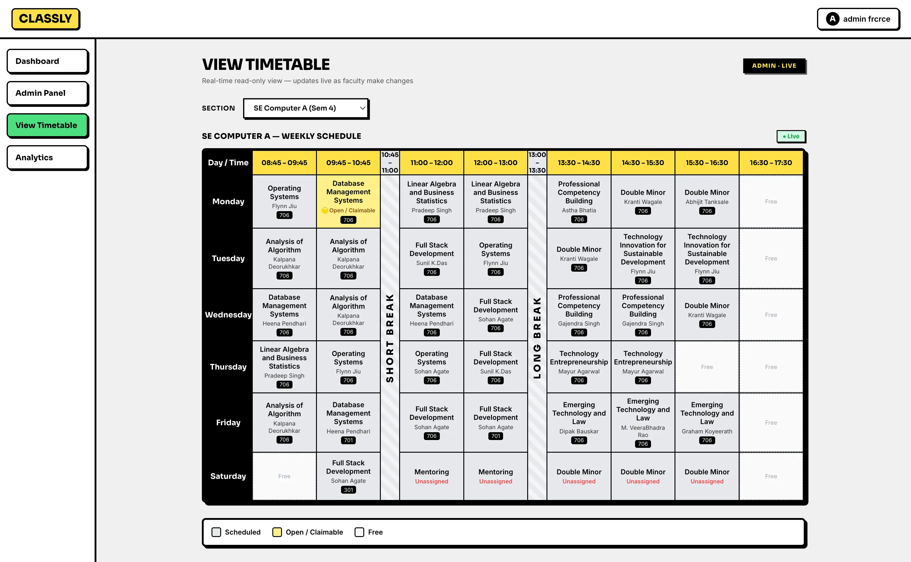
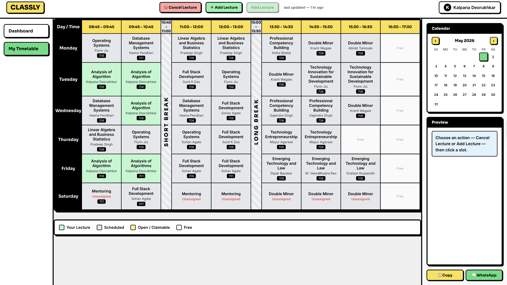
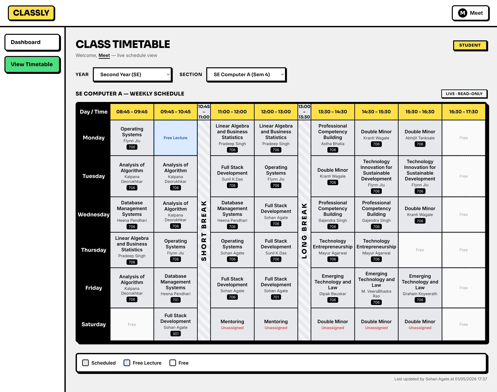
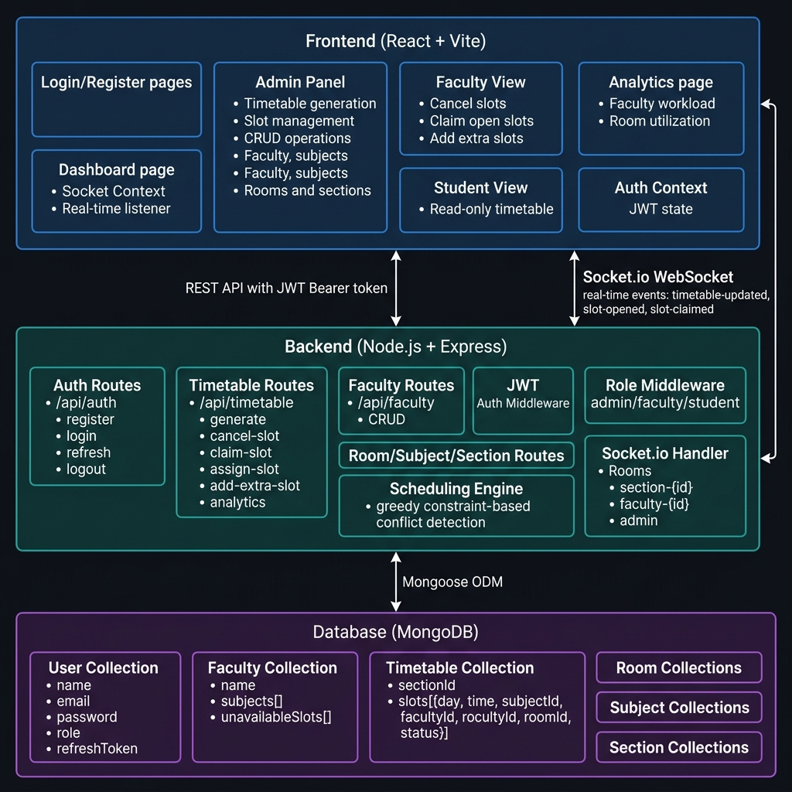

#  Classly — Smart Timetable Management System

> A real-time, role-aware academic timetable platform built on the MERN stack — automating scheduling, conflict detection, and live slot management across admin, faculty, and student roles.

<div align="center">
  <a href="https://www.youtube.com/watch?v=a_8Wqxs32dI">
    
  </a>
  &nbsp;&nbsp;
  <a href="#application-screenshots">
    
  </a>
</div>

---

## 📖 Overview

**Classly** solves the common pain points of manual academic scheduling:

- Timetables are tedious to build, error-prone, and hard to update.
- Faculty schedule changes (cancellations, extra classes) have no live propagation mechanism.
- Students and faculty often have no single source of truth for real-time slot status.

This system provides a **centralized, conflict-free scheduling engine** backed by real-time WebSocket communication. Admins can auto-generate timetables using a greedy constraint-based engine, faculty can manage their own slots, and students always see a live view — all without a page refresh.

---

## ✨ Features

### 🛡️ Admin
- **Auto-generate timetable** per section using the greedy scheduling engine (most-constrained-first)
- **Conflict detection** — no double-booking of faculty or rooms
- Full **CRUD** for Faculty, Rooms, Subjects, and Sections
- **Assign slots** directly to any faculty
- View **Analytics** — faculty workload and room utilization
- View and manage the **admin timetable view**

### 👨‍🏫 Faculty
- **Cancel** their own scheduled slots (opens them for others)
- **Claim open slots** left by other faculty via `ClaimSlotModal`
- **Add extra slots** for supplementary lectures
- View their **personal timetable** with full slot context
- Receive **real-time notifications** when slots are opened or claimed

### 🎓 Student
- **Read-only timetable view** for their section
- **Live updates** — timetable changes reflect instantly without refresh
- **Day-wise responsive layout** for mobile browsing
- Notified in real-time when timetable is updated

---

<a id="application-screenshots"></a>
## 📸 Application Screenshots

<div align="center">
  <h3>🛡️ Admin Panel & Dashboard</h3>
  
  
  <br/><br/>
  
  <h3>👨‍🏫 Faculty Timetable Management</h3>
  
  
  <br/><br/>
  
  <h3>🎓 Student Live Timetable</h3>
  
</div>

---

## 🛠️ Tech Stack

| Layer | Technology |
|---|---|
| **Frontend** | React 19, Vite 6, React Router DOM v7, CSS Modules |
| **Backend** | Node.js, Express.js |
| **Database** | MongoDB, Mongoose ODM |
| **Real-time** | Socket.io v4 (server + client) |
| **Authentication** | JWT (access token + refresh token), bcrypt |
| **Charts** | Chart.js, react-chartjs-2 |
| **Drag & Drop** | react-beautiful-dnd |
| **HTTP Client** | Axios |

---

## 🗂️ Folder Structure

```
minpro/
│
├── backend/
│   ├── config/
│   │   └── db.js                  # MongoDB connection setup
│   ├── controllers/
│   │   ├── auth.controller.js     # Register, login, refresh, logout logic
│   │   ├── faculty.controller.js  # Faculty CRUD
│   │   ├── room.controller.js     # Room CRUD
│   │   ├── section.controller.js  # Section CRUD
│   │   ├── subject.controller.js  # Subject CRUD
│   │   └── timetable.controller.js# All timetable + analytics logic
│   ├── engine/
│   │   ├── scheduler.js           # Greedy constraint-based timetable generator
│   │   └── conflictEngine.js      # Conflict detection (faculty + room)
│   ├── middleware/
│   │   ├── auth.js                # JWT token verification middleware
│   │   └── role.js                # Role-based access control middleware
│   ├── models/
│   │   ├── Faculty.js             # Faculty schema (name, subjects, unavailableSlots)
│   │   ├── Room.js                # Room schema
│   │   ├── Section.js             # Section schema
│   │   ├── Subject.js             # Subject schema
│   │   ├── Timetable.js           # Timetable schema (sectionId, slots[])
│   │   └── User.js                # User schema (name, email, password, role, refreshToken)
│   ├── routes/
│   │   ├── auth.routes.js         # /api/auth
│   │   ├── faculty.routes.js      # /api/faculty
│   │   ├── room.routes.js         # /api/rooms
│   │   ├── section.routes.js      # /api/sections
│   │   ├── subject.routes.js      # /api/subjects
│   │   └── timetable.routes.js    # /api/timetable
│   ├── socket/
│   │   └── socketHandler.js       # Socket.io init, room management, getIO()
│   ├── utils/                     # Shared backend utilities
│   ├── seed.js                    # Database seeding script
│   ├── syncFaculties.js           # Faculty sync utility
│   └── server.js                  # Express app entry point + HTTP server
│
├── frontend/
│   ├── public/                    # Static assets
│   ├── src/
│   │   ├── api/
│   │   │   └── axios.js           # Axios instance with auth interceptors
│   │   ├── components/
│   │   │   ├── AvailabilityManager.jsx  # Faculty availability slot manager
│   │   │   ├── ClaimSlotModal.jsx       # Modal to claim an open slot
│   │   │   ├── DragDropWrapper.jsx      # Drag-and-drop timetable wrapper
│   │   │   ├── Layout.jsx               # App shell / sidebar layout
│   │   │   ├── MiniCalendar.jsx         # Mini calendar widget
│   │   │   ├── NotificationBanner.jsx   # Real-time toast notifications
│   │   │   ├── ProtectedRoute.jsx       # Route guard by role
│   │   │   ├── SlotCard.jsx             # Individual timetable slot card
│   │   │   └── TimetableGrid.jsx        # Full timetable grid renderer
│   │   ├── context/
│   │   │   ├── AuthContext.jsx          # JWT auth state + login/logout helpers
│   │   │   └── SocketContext.jsx        # Socket.io connection + notification state
│   │   ├── hooks/
│   │   │   └── useSocket.js             # Custom hook for socket access
│   │   ├── pages/
│   │   │   ├── AdminPanel.jsx           # Admin CRUD + timetable management
│   │   │   ├── AdminTimetableView.jsx   # Admin read-only timetable view
│   │   │   ├── Analytics.jsx            # Faculty workload + room utilization charts
│   │   │   ├── Dashboard.jsx            # Shared landing dashboard
│   │   │   ├── FacultyView.jsx          # Faculty timetable + slot actions
│   │   │   ├── Login.jsx                # Login page
│   │   │   ├── Register.jsx             # Registration page
│   │   │   └── StudentView.jsx          # Student read-only timetable
│   │   ├── utils/
│   │   │   └── normalizeName.js         # Name normalization helper
│   │   ├── App.jsx                      # Root router + route definitions
│   │   ├── main.jsx                     # React entry point
│   │   └── index.css                    # Global styles
│   ├── index.html
│   ├── vite.config.js
│   └── package.json
│
└── README.md
```

---

## 🏗️ Architecture Diagram



```
┌──────────────────────────────────────────────────────────────┐
│                    Frontend (React + Vite)                    │
│  Login │ Dashboard │ AdminPanel │ FacultyView │ StudentView   │
│        │  Analytics │ AdminTimetableView                      │
│  AuthContext (JWT)    SocketContext (real-time)               │
└────────────┬─────────────────────────────────┬───────────────┘
             │  REST API (JWT Bearer Token)     │  Socket.io
             ▼                                  ▼  WebSocket
┌──────────────────────────────────────────────────────────────┐
│                   Backend (Node.js + Express)                 │
│  /api/auth   /api/timetable   /api/faculty                    │
│  /api/rooms  /api/subjects    /api/sections                   │
│                                                               │
│  Middleware: verifyToken → authorize([roles])                 │
│  Engine: scheduler.js + conflictEngine.js                     │
│  Socket: socketHandler.js                                     │
│    Rooms: section-{id} │ faculty-{id} │ admin                 │
└────────────────────────┬─────────────────────────────────────┘
                         │  Mongoose ODM
                         ▼
┌──────────────────────────────────────────────────────────────┐
│                    MongoDB Database                           │
│  Users │ Faculty │ Timetables │ Rooms │ Subjects │ Sections  │
└──────────────────────────────────────────────────────────────┘
```

---

## 🚀 Installation & Setup

### Prerequisites
- Node.js ≥ 18
- MongoDB (local or Atlas)
- npm

### 1. Clone the Repository
```bash
git clone https://github.com/How2Invade/minpro.git
cd minpro
```

### 2. Install Backend Dependencies
```bash
cd backend
npm install
```

### 3. Install Frontend Dependencies
```bash
cd ../frontend
npm install
```

### 4. Configure Environment Variables

**`backend/.env`**
```env
MONGO_URI=mongodb://localhost:27017/smart-timetable
ACCESS_TOKEN_SECRET=your_access_token_secret
REFRESH_TOKEN_SECRET=your_refresh_token_secret
PORT=5001
CLIENT_URL=http://localhost:5173
```

**`frontend/.env`**
```env
VITE_API_URL=http://localhost:5001
VITE_SOCKET_URL=http://localhost:5001
```

### 5. Seed the Database (Optional)
```bash
cd backend
node seed.js
```

### 6. Run the Backend
```bash
cd backend
npm run dev
```

### 7. Run the Frontend
```bash
cd frontend
npm run dev
```

The app will be available at **http://localhost:5173**

---

## 🔐 Environment Variables

| Variable | Where | Description |
|---|---|---|
| `MONGO_URI` | backend | MongoDB connection string |
| `ACCESS_TOKEN_SECRET` | backend | Secret for signing access JWTs |
| `REFRESH_TOKEN_SECRET` | backend | Secret for signing refresh JWTs |
| `PORT` | backend | Express server port (default: `5001`) |
| `CLIENT_URL` | backend | Frontend origin for CORS + Socket.io |
| `VITE_API_URL` | frontend | Base URL for Axios API calls |
| `VITE_SOCKET_URL` | frontend | Socket.io server URL |

---

## 🌐 API Overview

### Auth — `/api/auth`
| Method | Endpoint | Access | Description |
|---|---|---|---|
| POST | `/register` | Public | Register a new user |
| POST | `/login` | Public | Login and receive tokens |
| POST | `/refresh` | Public | Refresh the access token |
| POST | `/logout` | Public | Invalidate refresh token |

### Timetable — `/api/timetable`
| Method | Endpoint | Access | Description |
|---|---|---|---|
| GET | `/` | All | Get all timetables |
| GET | `/:sectionId` | All | Get timetable for a section |
| POST | `/generate-timetable` | Admin | Auto-generate timetable |
| POST | `/cancel-slot` | Admin, Faculty | Cancel a scheduled slot |
| POST | `/claim-slot` | Faculty | Claim an open slot |
| POST | `/assign-slot` | Admin | Assign a slot directly |
| POST | `/add-extra-slot` | Faculty | Add an extra lecture slot |
| PUT | `/update-slot` | Admin | Update a slot manually |
| GET | `/faculty/:facultyId` | All | Get a faculty's timetable |
| GET | `/analytics/faculty-workload` | Admin | Faculty workload report |
| GET | `/analytics/room-utilization` | Admin | Room utilization report |

### Faculty — `/api/faculty`
| Method | Endpoint | Access | Description |
|---|---|---|---|
| GET | `/` | All | List all faculty |
| GET | `/:id` | All | Get faculty by ID |
| POST | `/` | Admin | Create new faculty |
| PUT | `/:id` | Admin | Update faculty |
| DELETE | `/:id` | Admin | Delete faculty |

### Other Resources
- **`/api/rooms`** — Room CRUD (Admin)
- **`/api/subjects`** — Subject CRUD (Admin)
- **`/api/sections`** — Section CRUD (Admin)
- **`/api/health`** — Health check endpoint

---

## 🔌 Socket Events

All events are emitted server → client after a timetable-modifying action.

| Event | Payload | Triggered By | Who Receives It |
|---|---|---|---|
| `timetable-updated` | `{ changedSlot }` | Any timetable change | Section room broadcast |
| `slot-opened` | `{ slot }` | Slot cancellation | Section room + eligible faculty rooms |
| `slot-claimed` | `{ slotId }` | Faculty claims a slot | Section room broadcast |

**Client join (client → server):**
```js
socket.emit('join', { role: 'student' | 'faculty' | 'admin', id, sectionId })
```
This places the client into the correct Socket.io rooms for targeted broadcasts.

---

## 🎨 UI / UX Highlights

- **Neo-brutalism Design** — bold borders, strong contrast, raw but structured aesthetic
- **CSS Modules** — scoped, conflict-free styles across all pages and components
- **Responsive Layout** — sidebar collapses on mobile; timetable switches to day-wise card view
- **Interactive Timetable Grid** — slot cards show status (`scheduled`, `cancelled`, `open`) with color coding
- **Drag & Drop** — powered by `react-beautiful-dnd` for intuitive slot rearrangement
- **Real-time Toast Notifications** — `NotificationBanner` displays incoming socket events as floating toasts
- **Mini Calendar** — supplementary date navigation widget
- **Analytics Charts** — faculty workload and room utilization rendered with Chart.js

---

## 🔮 Future Improvements

1. **Push Notifications** — Email/SMS alerts for slot changes using Nodemailer or Twilio
2. **AI-based Smart Scheduling** — ML model to predict optimal timetables based on historical data and preferences
3. **Google Calendar Integration** — Sync timetable slots with Google/Outlook calendars
4. **Attendance Module** — Faculty marks attendance per slot; analytics track attendance rates
5. **Export to PDF / Excel** — One-click download of generated timetables for offline sharing
6. **Multi-semester Support** — Manage and archive timetables across academic semesters

---

## 📄 License

This project is submitted for **academic evaluation purposes**.  
For enquiries regarding reuse or collaboration, contact the contributors directly.

---

<p align="center">Built with ❤️ by M·S·Y·D </p>
